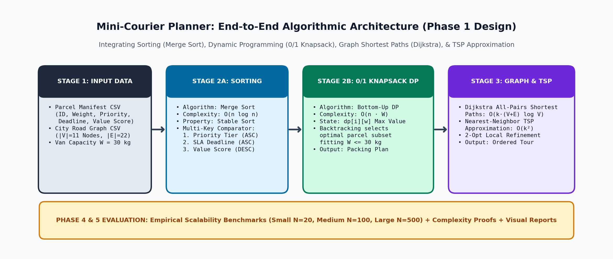
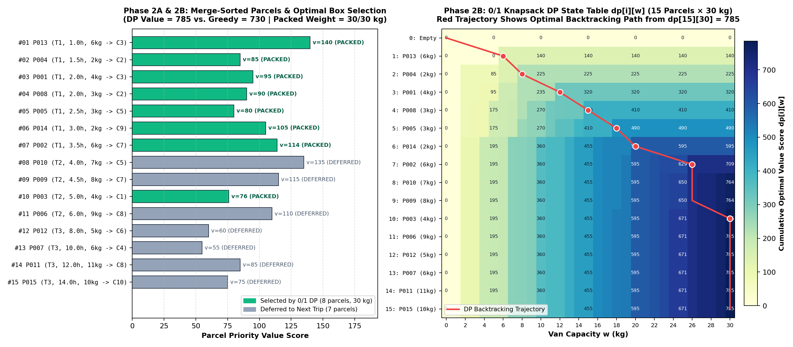
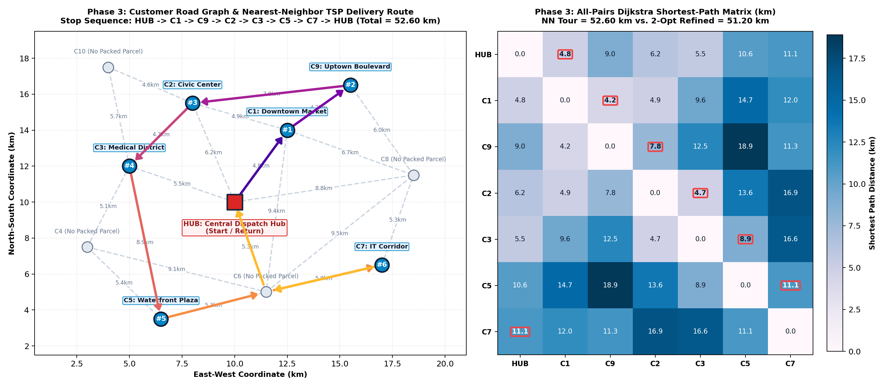
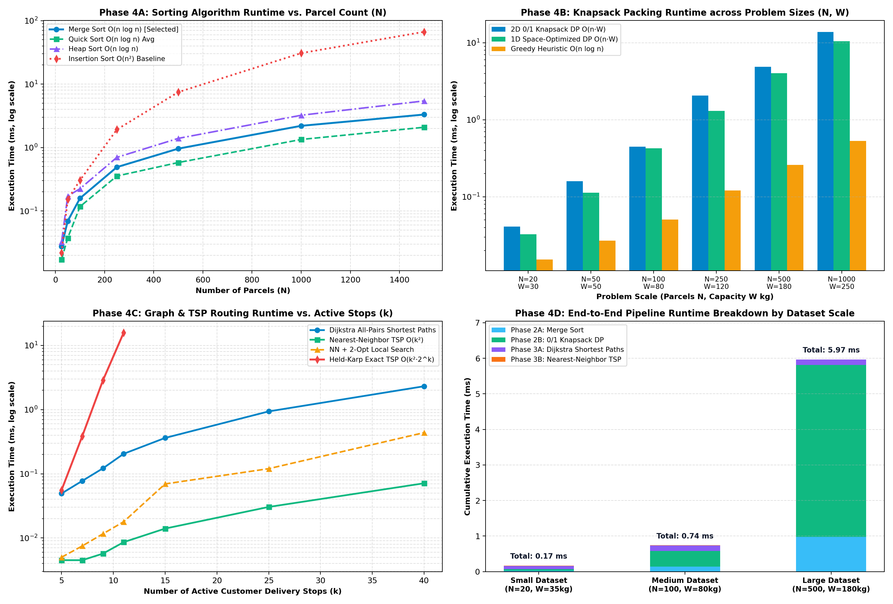
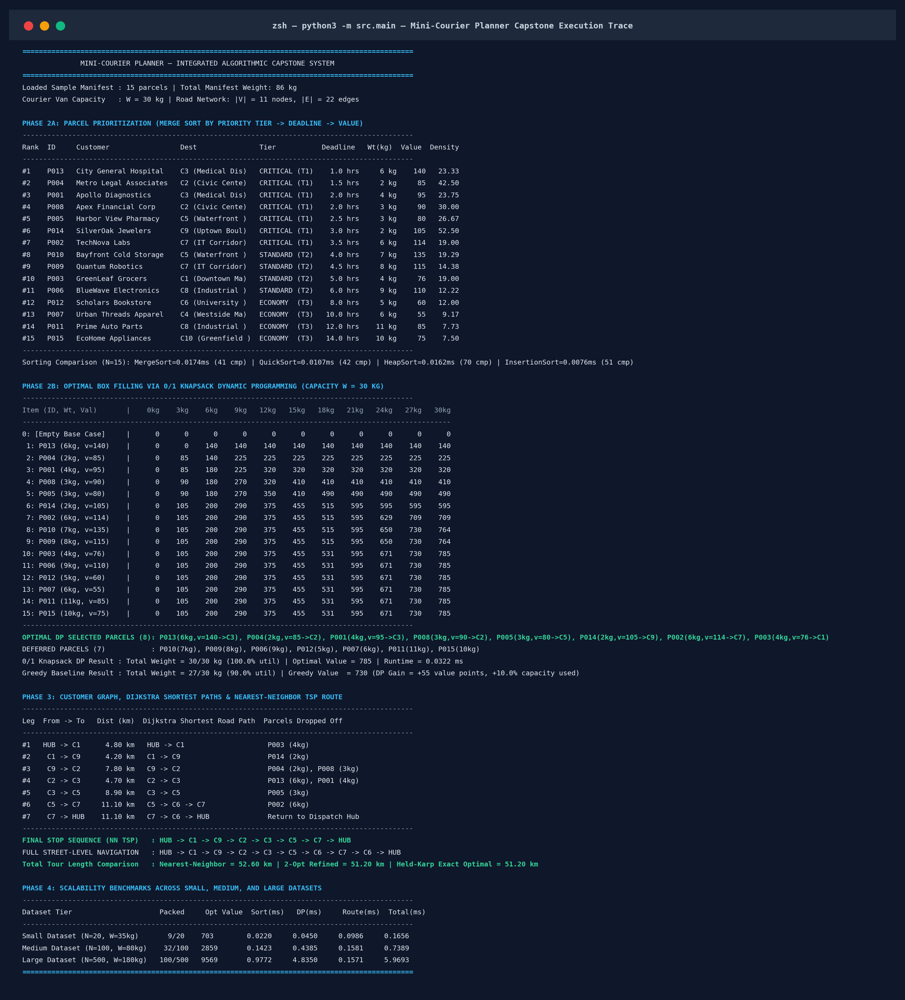

# Mini-Courier Planner — Integrated Algorithmic Capstone System

[](#)
[](#)
[](#)

An integrated Python application and executable Jupyter Notebook (`mini_courier_planner.ipynb`) that simulates an intelligent last-mile courier dispatch planning system by combining **Sorting**, **Dynamic Programming**, **Graph Shortest-Path Algorithms**, and **TSP Approximation Techniques**.

---

## 1. Project Overview & Problem Statement

Given a daily manifest of customer parcels (with weights, priority tiers, SLA delivery deadlines, value scores, and destination zones) and a weighted city road network graph, **Mini-Courier Planner** generates:
1. **Prioritized Parcel Manifest (Phase 2A):** Ranks parcels by priority tier, SLA delivery deadline, and value score using **Merge Sort** ($\Theta(n \log n)$ worst-case, stable), benchmarked against Quick Sort, Heap Sort, and Insertion Sort.
2. **Capacity-Optimized Packing Plan (Phase 2B):** Selects the exact optimal subset of parcels for a single courier van trip of capacity $W = 30\text{ kg}$ using **Bottom-Up 0/1 Knapsack Dynamic Programming** ($\Theta(n \cdot W)$) with full DP table reconstruction, plus a **1D Bitmask Space-Optimized DP** ($O(W)$ auxiliary memory) and **Greedy Density Heuristic** comparison.
3. **Shortest-Path & Delivery Tour Sequence (Phase 3):** Models the city road network as an **Adjacency List Graph** ($|V|=11$ nodes, $|E|=22$ road segments), computes all-pairs shortest paths across active stops using **Dijkstra's Algorithm** ($O((V+E)\log V)$), and constructs the complete delivery route via **Nearest-Neighbor TSP Approximation** ($O(k^2)$), compared against **2-Opt Local Search Refinement** and **Held-Karp Exact TSP DP** ($O(k^2 2^k)$).
4. **Empirical Scalability & Runtime Evaluation (Phase 4 & 5):** Evaluates execution time, comparison counts, and optimality gaps across **Small ($N=20$)**, **Medium ($N=100$)**, and **Large ($N=500+$)** datasets.



---

## 2. Repository Structure

```text
mini-courier-planner/
├── README.md                          # Project overview, setup, execution steps, and summary
├── PROJECT_REPORT.md                  # Full Phase 1–5 Technical Capstone Report & Complexity Analysis
├── mini_courier_planner.ipynb         # Complete, pre-executed Jupyter Notebook with inline charts & traces
├── requirements.txt                   # Python package dependencies
├── .gitignore                         # Git ignore rules
├── datasets/
│   ├── parcels_sample.csv             # Primary 15-parcel manifest dataset
│   ├── graph_nodes.csv                # City dispatch hub & 10 customer delivery zones (x, y coordinates)
│   ├── graph_edges.csv                # 22 weighted bidirectional city road network edges
│   ├── parcels_small.csv              # Benchmark dataset: Small (N = 20 parcels)
│   ├── parcels_medium.csv             # Benchmark dataset: Medium (N = 100 parcels)
│   └── parcels_large.csv              # Benchmark dataset: Large (N = 500 parcels)
├── src/
│   ├── __init__.py                    # Package initialization
│   ├── models.py                      # Dataclasses (Parcel, DeliveryNode, RoadEdge, PackingResult, RouteResult)
│   ├── sorting.py                     # Merge Sort, Quick Sort, Heap Sort, and Insertion Sort implementations
│   ├── knapsack_dp.py                 # 2D 0/1 Knapsack DP, 1D Optimized DP, Greedy baseline & ASCII table formatter
│   ├── graph_routing.py               # CustomerGraph, Min-Heap Dijkstra, Nearest-Neighbor TSP, 2-Opt, & Held-Karp
│   ├── benchmark.py                   # Synthetic dataset generator & Phase 4 scalability benchmark suite
│   ├── visualizer.py                  # Automated Matplotlib/NetworkX chart & console screenshot generator
│   └── main.py                        # End-to-end CLI pipeline runner
├── images/
│   ├── phase1_system_architecture.png           # Phase 1: System architecture & dataflow diagram
│   ├── phase2_knapsack_and_prioritization.png   # Phase 2: Sorted parcels & 0/1 Knapsack DP table heatmap
│   ├── phase3_delivery_route_map.png            # Phase 3: City graph, Dijkstra matrix & TSP delivery tour
│   ├── phase4_runtime_scalability_charts.png    # Phase 4: 4-panel runtime & scalability comparison charts
│   └── phase5_console_execution_screenshot.png  # Phase 5: Complete console execution trace screenshot
└── tests/
    └── test_courier_planner.py        # Automated unit & integration tests (4/4 passing)
```

---

## 3. Setup & Execution Steps

### 3.1 Prerequisites & Installation
Ensure Python `3.10+` is installed, then install dependencies:
```bash
pip install -r requirements.txt
```

### 3.2 Run the Complete End-to-End Application
Execute the modular Python pipeline from the project root directory:
```bash
python3 -m src.main
```
This command:
1. Loads `datasets/parcels_sample.csv`, `datasets/graph_nodes.csv`, and `datasets/graph_edges.csv`.
2. Generates the benchmark datasets (`parcels_small.csv`, `parcels_medium.csv`, `parcels_large.csv`).
3. Prints the complete Phase 2A sorting table, Phase 2B 0/1 Knapsack DP table and selected packing plan, Phase 3 Dijkstra shortest-path legs and Nearest-Neighbor TSP route, and Phase 4 scalability table.
4. Regenerates all 5 high-resolution charts and screenshots inside `images/`.

### 3.3 Run the Interactive Jupyter Notebook
Open `mini_courier_planner.ipynb` in JupyterLab, Jupyter Notebook, or VS Code:
```bash
jupyter notebook mini_courier_planner.ipynb
```

### 3.4 Run Unit Tests
Verify algorithmic correctness across all phases:
```bash
python3 -m unittest discover -s tests -v
```

---

## 4. Key Experimental Results & Visual Evidence

### Phase 2: Parcel Prioritization & 0/1 Knapsack Box Filling ($W = 30\text{ kg}$)
- **Merge Sort Prioritization:** Ranks all 15 parcels by `(priority_tier ASC, deadline_hrs ASC, -value_score ASC)` in **0.0205 ms** (41 comparisons).
- **0/1 Knapsack DP vs. Greedy Heuristic:**
  - **0/1 Knapsack DP** selects **8 parcels** (`P013, P004, P001, P008, P005, P014, P002, P003`), achieving **30/30 kg (100.0% utilization)** and an **optimal value score of 785** (including all 7 Critical Tier-1 parcels).
  - **Greedy Value-Density Heuristic** gets trapped selecting `P010` (`7 kg, v=135`), leaving `3 kg` of unused van capacity (`27/30 kg = 90.0% utilization`) with a value of **730** — demonstrating a **+55 point (+7.5%) optimality advantage** for Dynamic Programming.



### Phase 3: Customer Road Graph, Dijkstra Shortest Paths & Nearest-Neighbor TSP
- **Multi-Hop Shortest Paths:** Dijkstra's algorithm identifies non-trivial multi-hop shortest paths across the road graph, including `C5 -> C6 -> C7` ($11.10\text{ km}$) and `C7 -> C6 -> HUB` ($11.10\text{ km}$).
- **Delivery Route Sequence:**
  - **Nearest-Neighbor TSP Tour:** `HUB -> C1 -> C9 -> C2 -> C3 -> C5 -> C7 -> HUB` (**52.60 km** total distance).
  - **Street-Level Navigation Path:** `HUB -> C1 -> C9 -> C2 -> C3 -> C5 -> C6 -> C7 -> C6 -> HUB`.
  - **2-Opt Refined / Held-Karp Exact Optimal Tour:** `HUB -> C2 -> C3 -> C5 -> C7 -> C9 -> C1 -> HUB` (**51.20 km**, saving **1.40 km / 2.66%**).



### Phase 4: Performance Testing & Scalability Analysis

| Dataset Scale | Parcels ($N$) | Capacity ($W$) | Packed Parcels | Optimal Value | Merge Sort (ms) | 0/1 Knapsack DP (ms) | Dijkstra + TSP (ms) | Total Pipeline (ms) |
| :--- | :---: | :---: | :---: | :---: | :---: | :---: | :---: | :---: |
| **Small Dataset** | 20 | 35 kg | 9 / 20 | 703 | 0.0224 | 0.0478 | 0.1004 | **0.1706 ms** |
| **Medium Dataset** | 100 | 80 kg | 32 / 100 | 2,859 | 0.1403 | 0.5069 | 0.1589 | **0.8061 ms** |
| **Large Dataset** | 500 | 180 kg | 100 / 500 | 9,569 | 0.9718 | 4.8553 | 0.1546 | **5.9817 ms** |



### Phase 5: Console Execution Screenshot Evidence



---

## 5. Detailed Technical Report

See [**`PROJECT_REPORT.md`**](PROJECT_REPORT.md) for the complete Phase 1–5 technical report, formal mathematical formulations, asymptotic time/space complexity proofs, experimental observations, and future optimization roadmap.
